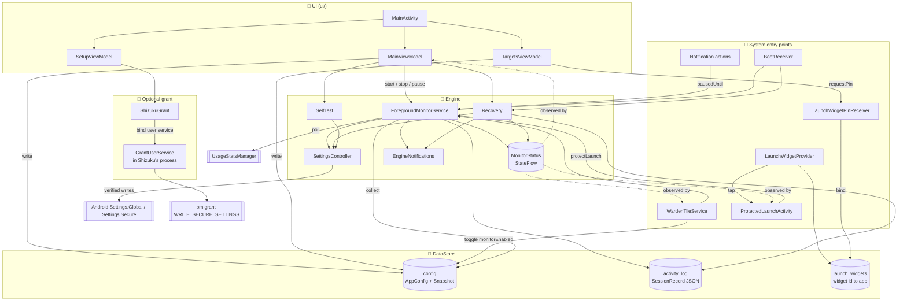
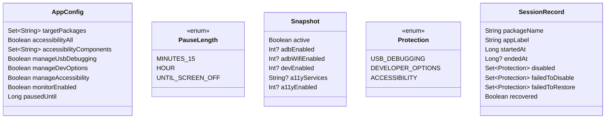
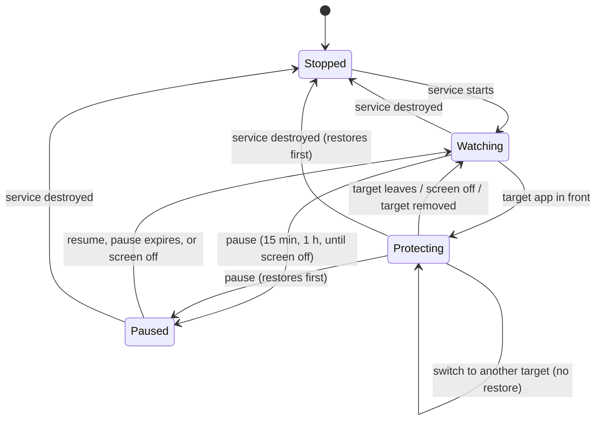
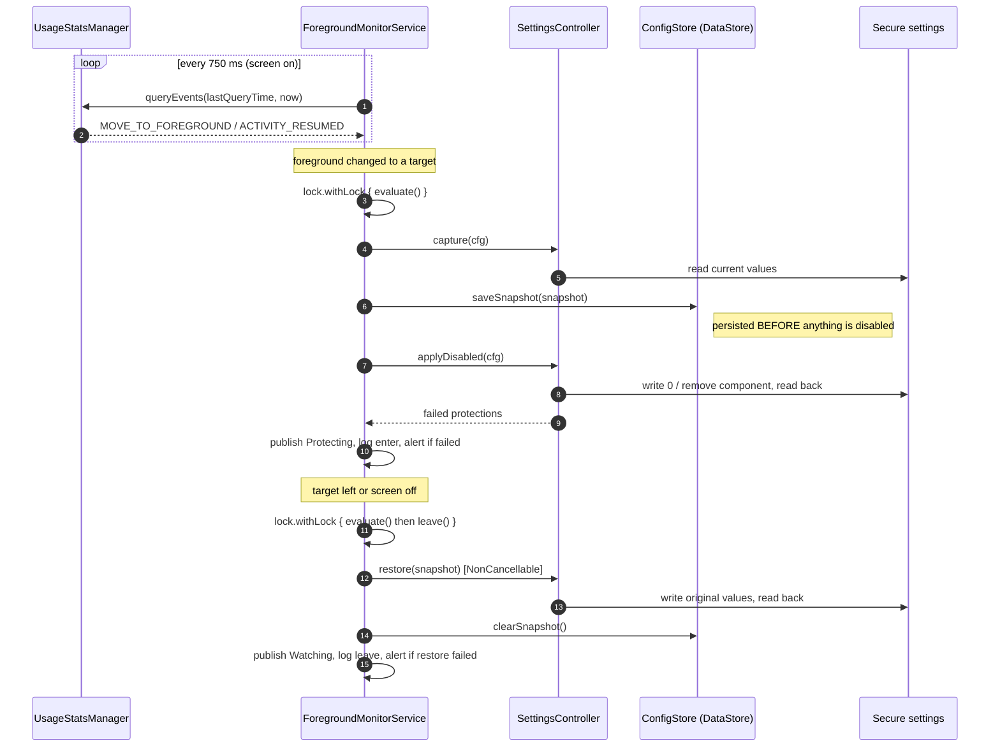
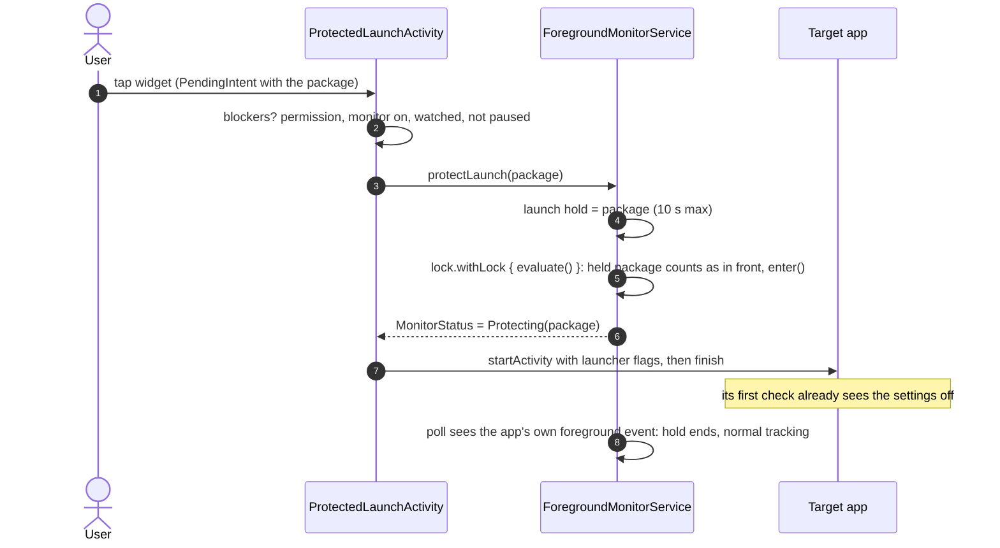
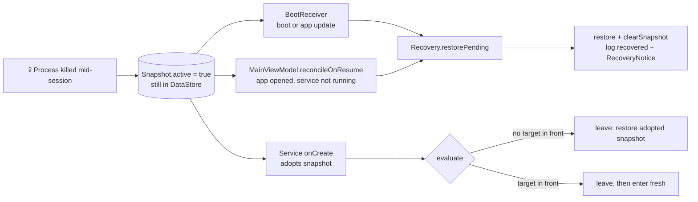
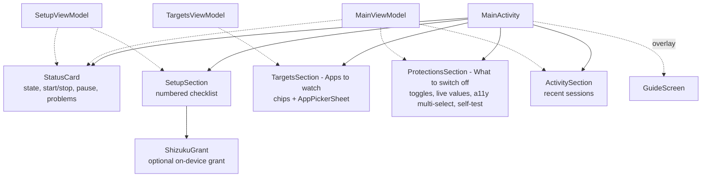

# 🏗️ Warden Architecture

Warden is a single-module, single-process Android app. A foreground service watches which app is in front and, while a user-chosen target app is visible, genuinely switches off up to three protections: USB debugging (with Wireless debugging), Developer options, and accessibility services (all of them by default, or a chosen set). When the target leaves, it restores exactly what was there before.

This document covers how that works and the invariants that keep it safe. For contributor rules, see [AGENTS.md](../AGENTS.md).

- [Components](#-components)
- [Monitor state machine](#-monitor-state-machine)
- [Session lifecycle](#-session-lifecycle)
- [Crash safety and recovery](#-crash-safety-and-recovery)
- [Concurrency model](#-concurrency-model)
- [Persistence](#-persistence)
- [Foreground detection and battery](#-foreground-detection-and-battery)
- [Failure handling](#-failure-handling)
- [UI layer](#-ui-layer)
- [Platform and OEM notes](#-platform-and-oem-notes)

---

## 🧱 Components

All code lives in `app.warden` (engine) and `app.warden.ui` (Compose UI).

| Component | Role |
|---|---|
| `ForegroundMonitorService` | The engine. Polls the foreground app, reconciles device state with config, owns the ongoing notification and its **Pause 1 hour** / **Resume** / **Hide** actions. `START_STICKY`, `specialUse` foreground service. |
| `SettingsController` | The **only** code that writes secure settings. Every write is verified by reading it back. Also holds the process-wide `lock`. |
| `ConfigStore` | DataStore wrapper exposing `AppConfig`, the persisted `Snapshot`, and the UI-only `selfTestSuggested` flag. Also defines `PauseLength` and the `PAUSE_UNTIL_SCREEN_OFF` sentinel. |
| `Recovery` | Idempotent fallback that restores a snapshot left behind by a hard-killed session. |
| `SelfTest` | Disables each managed setting, waits 800 ms for OEM reverts, verifies, then restores. |
| `MonitorStatus` | In-process `StateFlow<MonitorState>` plus a one-shot `RecoveryNotice`. No IPC, no persistence. |
| `ActivityLog` | Bounded (20 records, newest first) session history in its own DataStore file. |
| `EngineNotifications` | Notification channels (`monitor` low importance, named "Monitor (safe to turn off)" so the screen **Hide** opens carries the hint; `alerts` default), text, and failure alerts. Re-creating a channel on start updates its name and description on existing installs. |
| `ShizukuGrant` | Optional no-computer grant. Reports where the Shizuku route stands (`ShizukuStatus`) and runs the grant through a short-lived Shizuku user service. Used only by Setup. |
| `GrantUserService` | Runs inside Shizuku's shell-identity process (AIDL `IGrantService`). Execs `pm grant` for `WRITE_SECURE_SETTINGS` and nothing else, then exits on unbind. |
| `WardenTileService` | Quick Settings tile. Observes state only while visible; toggles `monitorEnabled`. |
| `BootReceiver` | On `BOOT_COMPLETED` / `MY_PACKAGE_REPLACED`: run Recovery, then restart the monitor if enabled. |
| `LaunchWidgets` / `LaunchWidgetProvider` | The **Protected launch** home-screen widget: one watched app per widget, stored in `launch_widgets`, drawn as the app's icon with a Warden badge: 44 dp on phones, 56 dp on tablets and unfolded foldables (`values-sw600dp`). On Android 12+ it also offers an icon-only size, which the launcher uses when a cell is too short for the name, so nothing is clipped. The provider redraws on `APPWIDGET_UPDATE` and on options changes (`onAppWidgetOptionsChanged`): after Warden is updated, One UI drops the drawn widget and sends only the options broadcast, so without that redraw the widget stayed the bare "Your app" placeholder, which does nothing when tapped. See [Protected launch](#protected-launch-widget). |
| `LaunchWidgetPinReceiver` | Not exported. Success callback for a widget placed from inside Warden: binds the new widget id to its app and reports it on `LaunchWidgets.added`. |
| `ProtectedLaunchActivity` | Invisible trampoline behind the widget: asks the service to protect the app, waits for `Protecting`, then opens it. Never writes settings itself. |
| `LaunchWidgetConfigActivity` (ui) | Picks the widget's app from the watched apps, when it is placed or when its app is gone. |

### Data model

A `null` field in `Snapshot` means "not managed, do not touch on restore". Accessibility is only managed when `manageAccessibility` is on **and** there is something to switch off (`AppConfig.managesAccessibility`): either `accessibilityAll` (the default) or a non-empty `accessibilityComponents`.

- **All mode** writes an empty `enabled_accessibility_services` list and `accessibility_enabled = 0`; it is verified by the list reading back empty.
- **Selected mode** removes only the chosen components from the list (and sets `accessibility_enabled = 0` if nothing is left); it is verified by none of them reading back.
- Either way the snapshot holds the **full** pre-session list and flag, so restore is identical in both modes.

**USB debugging includes Wireless debugging** (`adb_wifi_enabled`, Android 11+): both run the same adb daemon, which some apps look for directly. The snapshot keeps it in its own field (`adbWifiEnabled`, null in snapshots saved before it was managed, so those restore as before). It is written only when it is on, and put back only when it changed, since switching it on restarts the daemon.
- Installs from before multi-select used a single `a11y_component` key. `ConfigStore` seeds `a11y_components` from it and drops it on the first selection write; `a11y_all` defaults to `true`.

---

## 🔄 Monitor state machine

`MonitorState` is published by the service into `MonitorStatus` and drives the notification, the status card and the tile.

- `Watching(targetCount, restoreFailed)` - running, nothing disabled. `restoreFailed` is non-empty if the last restore could not put something back.
- `Paused(untilMillis)` - wall-clock pause. Pausing is **only** a write to `AppConfig.pausedUntil`; the notification buttons and the UI both do exactly that and the service reacts. "Until screen off" stores `PAUSE_UNTIL_SCREEN_OFF` (`Long.MAX_VALUE`, so every "is paused" check still works). `ConfigStore.endScreenOffPause()` clears it on `SCREEN_OFF` and on every service start, because a new process can't know whether the screen went off in between; ending a pause early is the safe direction.
- `Protecting(pkg, label, disabled, failed)` - a target is in front.
- `Stopped` - also the value after process death, which is correct because the service died with it.

---

## 🎬 Session lifecycle

`evaluate()` is the single reconciler. It runs on a foreground change, on a config change (targets or pause), on screen off, on a pause expiring, on a widget launch or its hold expiring, and once after start. It is idempotent and only writes on an actual transition.

### Enter

1. `SettingsController.capture` reads only the settings the config manages.
2. The snapshot is held in memory (source of truth) **and** persisted (crash-durable copy) before any write.
3. `applyDisabled` switches each protection off and returns the ones that failed.
4. Any unexpected exception calls `leave()` immediately, so settings are never left half-disabled.

### Switch

Moving directly from one target to another keeps the current snapshot and disabled set. There is no restore/disable round trip.

### Leave

Runs inside `withContext(NonCancellable)` so a restore always finishes, even while the service scope is being cancelled. Accessibility is compared as a **set of normalized components**, because the accessibility manager may reorder the list or drop stale entries after a write.

### Protected launch (widget)

Polling has a blind spot. An app that checks Developer options in the first half second of a cold start (Mumbai One, a Flutter app, does exactly this) always beats the next 750 ms poll, sees the settings on and refuses to run. Reopening it loses the same race. The **Protected launch** widget closes the gap by switching the settings off before the app starts.

- `ProtectedLaunchActivity` is an invisible trampoline: translucent, no animation, its own task (empty `taskAffinity`), no history. It never writes settings. It asks the service, which owns sessions, snapshots and restore, so enter, crash safety and restore are the ordinary paths.
- It waits for `MonitorStatus` to report `Protecting(package)` for up to 2 s, then opens the app regardless. Once protected, it also waits (up to 1 s, read-only) until the adb daemon reports stopped (`init.svc.adbd`): Android stops it a moment after debugging is switched off, and an app that looks for it as it opens would still find it. No wait while debugging is still on. A timeout or a blocker (no permission, monitor off, paused, not watched) shows a toast and opens the app as its icon would, so the widget is never worse than the icon.
- **The launch hold.** Between the tap and the app's own foreground event, the polled foreground app is the launcher or Warden, which would make `evaluate` restore straight away. While the hold is set, `evaluate` treats the held package as in front. The hold ends when a foreground event for that package arrives that is newer than the hold (one from before the tap does not count), after `LAUNCH_HOLD_MS` (10 s) on the monotonic clock, or on screen off. It lives in memory only and is never persisted, so a new process starts without one, and a clock change can never stretch it.
- Pause and the watch list still apply: a held package that isn't watched, or a paused monitor, protects nothing.
- Each widget is bound to one package in the `launch_widgets` DataStore. The picker lists only watched apps, and because it is exported for launchers it only accepts widget ids that belong to Warden's provider. A widget whose app was uninstalled shows **Choose app** and reopens the picker.

#### Adding a widget from inside Warden

**Add home screen widget** (Apps to watch) calls `LaunchWidgets.requestPin`, which is `AppWidgetManager.requestPinAppWidget` with:
- an `EXTRA_APPWIDGET_PREVIEW` built from the same `RemoteViews` as the real widget, so the launcher's dialog shows the app's own icon and name;
- an explicit, mutable success-callback `PendingIntent` to `LaunchWidgetPinReceiver`, one per package. It is mutable because the system adds `EXTRA_APPWIDGET_ID` to it, which needs `FLAG_MUTABLE` from Android 12, and explicit because Android 14 forbids mutable implicit ones.

Launchers skip the widget's picker for an app-requested pin (Launcher3's `PinWidgetFlowHandler.needsConfigure()` is false), so the receiver is the only place the app gets set. It checks the id is Warden's, binds it, and emits the label on `LaunchWidgets.added`. That is an in-process `SharedFlow` like `MonitorStatus`, which `TargetsSection` turns into a snackbar. In case a launcher opens the picker anyway, the receiver marks the id as freshly pinned (in memory, and only once the bind succeeded) and the picker accepts and closes once within 10 s. Reconfiguring the widget after that still shows the picker. Store reads and writes with their render go through one `Mutex`: a pin sends `APPWIDGET_UPDATE` and then the callback, both handled in the background, and unserialized the update could draw "Choose app" over the freshly bound widget. With one watched app the button pins straight away; with several, a chooser dialog asks first and pins only after its own exit, so two dialogs never overlap. If `isRequestPinAppWidgetSupported` is false, or the launcher refuses, a dialog shows the manual steps.

### Edge cases

- **Screen off** clears the known foreground app and evaluates, so protections are restored while the phone is locked. It also ends any launch hold.
- **Clock changes.** Foreground events carry wall-clock times, and the poll drops any event not newer than the last one taken. If the clock goes back (set by hand or corrected), the poll sees `now` behind its last query and starts over from the new time, so app switches are not ignored until the clock catches up.
- **Paused** or **target removed from config** both make the current app a non-target and trigger a restore.
- **Changing a managed setting during a session** is overwritten on leave by the snapshot. This is documented to the user in the guide.

---

## 💥 Crash safety and recovery

The service can die without `onDestroy` (OOM kill, force stop, OEM battery manager). The persisted snapshot is what makes that recoverable.

- **Adoption.** On start, the service loads any active snapshot into memory and marks it `adopted`. If a target is in front it first restores, then enters a clean session, so the snapshot it holds is the true "before" state.
- **Double-restore guard.** If an adopted snapshot is found already cleared on disk, `Recovery` got there first and already reported; the service skips restoring and reporting again.
- **Live-session guard.** Recovery restores only when no session is live: under the lock it skips while `MonitorStatus` reports `Protecting`. `BOOT_COMPLETED` can arrive well after unlock, when the user may already be in a watched app, and restoring then would switch settings back on in front of it.
- **Startup window.** The first poll looks back to boot, capped at 6 h (`INITIAL_WINDOW_MS`), so after a restart the app currently in front is found from its last foreground event even if the user has been in it for a long time. The screen state is read from `PowerManager.isInteractive` on start, so a restart while the phone is locked does not poll.
- **Self-test** persists a snapshot too, so a crash mid-test is undone the same way.
- **Backups are disabled.** `allowBackup="false"` plus `data_extraction_rules.xml` exclude everything from cloud backup and device-to-device transfer. A snapshot carried to another phone would "restore" stale values there (for example, re-enabling USB debugging).

---

## 🔐 Concurrency model

| Primitive | Guards |
|---|---|
| `SettingsController.lock` (process-wide `Mutex`) | Every state transition: service `evaluate`/`enter`/`leave`, `Recovery.restorePending`, `SelfTest.run`. A self-test can never interleave with a real session. |
| `pollMutex` (service-local) | The shared, reused `UsageEvents.Event` object between the poll loop and the `SCREEN_ON` receiver. |
| `NonCancellable` | Every restore path, so cancellation can never strand disabled settings. |
| `stopping` flag | Set in `onDestroy` before the synchronous final `leave()`, so an evaluation queued behind the lock cannot re-enter a target afterwards. |
| `launchHold` (`AtomicReference`) | Set from `onStartCommand`, read and ended from `evaluate` and the poll. Ended with compare-and-set, so a newer widget tap is never wiped by an older hold ending. |
| `ready` (`CompletableDeferred`) | A widget launch that starts the service waits until config is loaded and any leftover snapshot adopted before it evaluates. |
| `TargetsViewModel.writeLock` | Serialized read-modify-write of `targetPackages`, so rapid taps never overwrite each other. |

`SelfTest` uses `tryLock` and returns `Busy` instead of waiting if a session is active or a snapshot is pending.

---

## 💾 Persistence

Three DataStore Preferences files:

| File | Contents | Written |
|---|---|---|
| `config` | `AppConfig` keys (including `a11y_all`, `a11y_components`, `paused_until`), `snap_*` snapshot keys (with `snap_has_*` presence flags so `null` survives), and the UI-only `self_test_suggested` | On user action, and at session transitions for the snapshot |
| `activity_log` | One JSON array string of up to 20 `SessionRecord`s | Only at enter, leave and recovery - never per poll |
| `launch_widgets` | `widget_<id>` to package, one per Protected launch widget | When a widget's app is picked, and when a widget is removed |

Both files have a `ReplaceFileCorruptionHandler`: without one, a single corrupt file makes every read throw for good. `activity_log` simply starts over, and so does `launch_widgets` (its widgets then ask for an app again). `config` starts over from defaults **plus a `reset_after_corruption` marker**, because the saved restore state was in that file. `Recovery.reportConfigReset` (run by the service on start and by `Recovery.restorePending`) consumes the marker once and posts an alert asking the user to check the three settings by hand. The marker is consumed only when the alert can actually show (notifications allowed and the alerts channel on); otherwise it waits for a later start.

`selfTestSuggested` is deliberately outside `AppConfig`: the service collects `config`, and a UI-only flag must not wake it.

---

## 🔋 Foreground detection and battery

- Foreground app comes from `UsageStatsManager.queryEvents`, taking the latest `MOVE_TO_FOREGROUND` or `ACTIVITY_RESUMED`. Warden runs **no accessibility service of its own**.
- **Screen on:** poll every 750 ms. Change detection means `evaluate` only does work on an actual foreground change. Query windows overlap by 2 s (`QUERY_OVERLAP_MS`), because the system stamps an event before committing it on another thread; events already taken are dropped by timestamp.
- **Screen off:** polling stops. A 5 s idle heartbeat only checks for a pause expiring or a pending first evaluation. `SCREEN_ON` wakes polling immediately and forces one full evaluation, since a poll racing `SCREEN_OFF` can leave the known foreground app stale.
- **Paused, or nothing to watch:** the same 5 s heartbeat with the screen on. With no apps chosen or a pause running there is nothing for a poll to find (an hour's pause was about 4,800 wasted queries). The heartbeat shortens itself to wake when a timed pause ends, and a config change (resume, targets added) polls before it evaluates, because the app in front may have changed meanwhile. A widget launch in progress counts as watching. The screen receiver's handlers wait for start-up (`ready`) before they evaluate, so they never act on default config.
- **System screens over a watched app:** the runtime permission prompt and the app chooser count as part of the watched app while a session is running, so a prompt the app raises doesn't restore settings under it (and make the app race the re-disable when it resumes). Their packages are resolved from `REQUEST_PERMISSIONS` and `ACTION_CHOOSER` once, never Warden or the home screen. Leaving to home or any other app, screen off and pause still restore at once.
- One `UsageEvents.Event` is reused for every poll; the active snapshot lives in memory and DataStore is touched only at transitions.
- The ongoing notification is re-posted only when the state actually changes.
- The Setup grant step re-checks the permission once a second, but only while that step is on screen and the app is resumed (`repeatOnLifecycle(RESUMED)`), because the adb command usually runs with Warden still open and there is no resume to trigger a refresh. It stops as soon as the step is done. Each tick reads only that one permission; the full `refresh()` runs once it changes.
- Release builds use R8 minification and resource shrinking because the service runs around the clock.

---

## 🚨 Failure handling

| Situation | Detection | Result |
|---|---|---|
| `WRITE_SECURE_SETTINGS` missing | `checkSelfPermission` | Setup step stays incomplete; Start is disabled; self-test returns `NoPermission`. |
| OEM blocks or silently reverts a write (e.g. Samsung `adb_enabled`) | Read-back after every write; self-test waits 800 ms then re-checks | Reported in `Protecting.failed`, a disable alert, and the activity log. |
| Restore did not take | Read-back / set comparison | `Watching.restoreFailed`, a restore alert, and `failedToRestore` in the log. Alert is cancelled after the next clean restore. |
| Unexpected exception during enter | `try/catch` around enter | Immediate `leave()` and a disable alert for all managed protections. |
| Service killed | Persisted snapshot | Recovery path above, with a one-time snackbar via `RecoveryNotice`. |
| Logging fails | `runCatching` | Ignored. Logging must never break or delay a transition. |
| A DataStore file is corrupt | `ReplaceFileCorruptionHandler` | File replaced. For `config`, a one-time "settings were reset" alert, since a pending restore may have been lost. |
| Notifications denied, or the `monitor` channel turned off with **Hide** | `runCatching` around every notify | Engine keeps working silently; Alerts still post if their channel is on. |
| Shizuku grant fails (not running, permission refused, `pm` error, 15 s bind timeout) | `ShizukuGrant.grant` returns a reason; `refresh()` re-checks the real permission | Logged, and Setup shows "Allow Warden in Shizuku" or "Use the computer steps above". The adb route is always still there. |

---

## 🎨 UI layer

A single `MainActivity` hosts a scrolling column of section cards, with the guide as a full-screen overlay (not navigation, so scroll position is kept).

- **UX rules** (Apple's design principles, expressed in Material so the app stays familiar on Android):
  - *Common path first:* the screen reads status, setup, apps to watch, then what to switch off; most people never change the defaults below the apps.
  - *Forgiveness:* one-tap destructive actions (removing a watched app, clearing activity) offer **Undo** through `offerUndo` and the screen's `LocalSnackbarHostState`. A confirmation dialog is kept only for the self-test, which really does drop adb.
  - *Mapping:* a protection's subtitle describes the phone ("On now", "Already off") or says Warden leaves it alone ("Left as is"), so it never contradicts its switch.
  - *Wayfinding:* system Back closes the guide overlay rather than leaving the app. Each "Finish setup" item is a button that goes straight to its fix: usage access opens Settings, a missing app or service opens its picker (picker visibility lives in `MainScreen` for this), and the grant scrolls the Setup card into view.
  - *First success:* once setup is done, the status card offers the self-test once (`selfTestSuggested`, UI-only), so people see it work before they need it.
  - *Large text and big screens:* side-by-side status buttons stack at font scale 1.3+, and content is capped at `ContentMaxWidth` (600 dp) and centered. Both full-screen Scaffolds and their top bars use `ScreenInsets` / `TopBarInsets` (`safeDrawing`): the window draws into the camera cutout, which Material's defaults don't clear, so in landscape it could cover the title. State a fold, unfold or rotation would otherwise reset (open pickers, the app search, the expanded activity list) is `rememberSaveable`, and the self-test dialog scrolls so Done stays reachable on short screens.
  - *Scroll edges:* the top bar tints when content scrolls under it (`pinnedScrollBehavior`) instead of a hard cut.
  - *Multimodal feedback:* `rememberHaptics()` fires a confirm on monitor start/stop and a confirm or reject on the self-test verdict, and nowhere else.
- **View models** are `AndroidViewModel`s that read `ConfigStore`, `ActivityLog` and `MonitorStatus` and expose `StateFlow`s.
- **On every resume** (`MainActivity.onResume`, not a Compose lifecycle observer - an observer added from the first composition can miss the cold-start resume): `SetupViewModel.refresh()` re-reads permissions, `MainViewModel.reconcileOnResume()` runs Recovery and restarts the service if it is enabled but not running, `refreshDeviceState()` re-reads live setting values and installed accessibility services, and `TargetsViewModel.refreshIfAppsChanged()` reloads the app list only if `PackageManager.getChangedPackages` reports an install, removal or update since the last load (the service keeps the process, and so the ViewModel, alive for days). Every way into the app (notification, alerts, tile, widget picker) uses `MainActivity.openIntent`, the launcher's own MAIN/LAUNCHER intent, because Android reuses a task only for an intent matching the one that started it; a plain component intent stacked a second copy of the screen. On a cold start the first frame waits (the launch splash stays up, capped at 1 s) until saved config, watched apps, the activity log and live values have loaded, so the screen never opens on defaults and animates into the real state. After a full hide (`onStop`) the Setup refresh alone waits for `onEnterAnimationComplete` (fallback 600 ms): a step that changed in Settings collapses with an animation, and run during the system's window animation back into the app it fought it for the GPU (93% janky frames on a Moto E13, against 2 of 19 deferred). Returning from a dialog-style screen, or with animations off, refreshes at once; Recovery is never deferred.
- **Notification permission** is requested in context when the user taps Start, and never blocks starting.
- **Status card actions:** Start / Stop, and **Pause** as a menu (15 minutes, 1 hour, until the screen turns off) anchored to the button. Resume while paused.
- **Grant step:** adb first (instructions, the shared `AdbGrantCommand` box with Copy, maker hints, a Developer options shortcut), then a "Rather skip the computer? Use Shizuku" disclosure row, closed by default and opened automatically while Shizuku is running or a Shizuku attempt just failed (`rememberSaveable` keyed on that, so the grant poll never resets it). It reveals with `SetupReveal` and a chevron on the same spec, and holds four numbered steps (`ShizukuSteps`, shared with the guide, which shows them inline under the Copy button) and one button that follows `ShizukuStatus`: **Get Shizuku**, **Open Shizuku**, then **Grant with Shizuku**, which asks for Shizuku's permission first if needed and continues from the result listener.
- **Usage access step:** on Android 15+ it also shows the way past "restricted settings" (app settings, three-dot menu, Allow restricted settings) with an **Open app settings** button. Android 15+ guards Usage access for apps from installers it doesn't trust, including a tapped APK download, and only the app's own page lifts it. The trusted-installer list isn't readable by apps, so the hint shows on every 15+ phone while the step is incomplete. Help's "Not working?" carries the same tip.
- **Top bars:** the title is the only text; actions are icons. Help is a "?" `IconButton` (Material `help_outline`, a single drawable rather than material-icons-extended) whose label is its content description and its long-press tooltip. Both bars tint only when content scrolls under them (`pinnedScrollBehavior`), and titles are marked as headings for TalkBack.
- **Help** (`GuideScreen`): opens only from the top bar, never by itself, and closes with an X rather than a back arrow, since it is a sheet that rises over the main screen and drops back down; the Setup card is the onboarding and shows the restore promise while setup is incomplete. Six short cards (restore promise, set up once, what to add, day to day, pro tips, not working?). "Not working?" starts with the most common cause: the monitor was never started after setup. The setup card reuses `AdbGrantCommand`, so the command and its Copy button are identical to Setup.
- **Theme:** follows the system light/dark setting, with no in-app switch. Material 3 dynamic color on Android 12+; below that, complete brand palettes (every role set, so no Material-default purple leaks in; light primary is tone 40 `#1A51DC` for AA contrast on cards). Dark is true black for OLED (`amoled()` in `Theme.kt`): background, surface and the top bar are `#000000`, and each surface container keeps its own hue but drops to a low tone (sheet 6, scrolled bar and menus 8, cards and dialogs 12, inset panels 18), so cards still separate without grey slabs. Text and accent roles are untouched, so contrast only goes up. `values-night` makes the window behind Compose black, so a fold, unfold or rotation can't flash white. The splash stays brand navy `#131D5E` in both modes; notification accent `#2F4DD8`.
- **Motion:** one small system in `Motion.kt` / `Components.kt`, applied everywhere.

  | Use | Curve | Duration |
  |---|---|---|
  | Press feedback (`pressScale`, scale 0.97) | strong ease-out | 160 ms |
  | Reveals and crossfades (`motionTween`) | strong ease-out `(0.23, 1, 0.32, 1)` | 200 ms |
  | Dialogs and the guide overlay (`modalTween`) | strong ease-out | 250 ms |
  | Anything leaving (`exitTween`) | strong ease-out | 150 ms |
  | On-screen size changes (`morphTween`) | strong ease-in-out `(0.77, 0, 0.175, 1)` | 250 ms |
  | Color changes (`colorSpec`) | ease `(0.25, 0.1, 0.25, 1)` | 200 ms |

  Dialogs (`AnimatedDialog`) fade and scale in from 0.96 and leave the same way before the caller is told they closed. They draw their own backdrop on the same transition (the window dim would linger after the surface left), and start the entrance on the dialog window's first frame, because creating that window can take longer than the entrance on slower phones. The Help overlay slides with `AnimatedVisibility` but fades through its own `graphicsLayer` with `CompositingStrategy.ModulateAlpha`: the stock `fadeIn`/`fadeOut` render the whole screen through an offscreen buffer that a low-end GPU allocates and clears on every open and close. No overshoot anywhere; switches, checkboxes and the bottom sheet keep their native motion. Everything snaps when the system "remove animations" setting is on (`LocalReducedMotion`, re-read on every resume so changing it applies without a restart).
- **Accessibility:** `StatusDot` takes a content description whenever color is the only signal; decorative icons and app-icon placeholders are hidden; guide lines, self-test outcomes and session rows are merged for TalkBack; buttons keep a 48 dp minimum height. Changes are announced through polite live regions: the status card and the self-test put theirs on the `AnimatedContent` container (each state is a new node, and only an existing live region is announced) with `hiddenWhileExiting` keeping the outgoing state from being read; Setup's title and progress announce as steps complete. Help and both dialogs set a `paneTitle` so TalkBack announces them; screen, card, step and dialog titles are headings, and each setup step's title carries its status ("step 1, done"). The adb command shrinks to fit only when that needs 75% or more of the reader's text size; otherwise it keeps their size and wraps.
- **Strings** are split per feature: `strings_main.xml`, `strings_setup.xml`, `strings_targets.xml`, `strings_engine.xml`, `strings_guide.xml`, `strings_widget.xml`. Shared ones live in `strings.xml`.

---

## 📱 Platform and OEM notes

- **minSdk 26, target/compile 35, JDK 17.**
- Version-gated behavior: notification permission (13+), tile subtitle (10+), background-restriction check (9+), "pause app if unused" step (11+), Shizuku option (11+, or below if Shizuku is already running), `startActivityAndCollapse(PendingIntent)` (14+).
- The ongoing notification is deliberately not `setOngoing`: on Android 13+ it can be swiped away while the service keeps running, and state changes then stop re-posting it for the rest of that run (`notificationDismissed`). Its **Hide** action opens `ACTION_CHANNEL_NOTIFICATION_SETTINGS` for the `monitor` channel (added only if that screen resolves); turning the channel off hides the notification while the service stays in the foreground. Alerts use their own channel, so they are unaffected.
- `ForegroundServiceStartNotAllowedException` from the tile falls back to opening the app, whose resume handler restarts the service.
- `installation { installOptions += "--user 0" }` keeps adb installs out of Samsung's Dual Messenger profile (user 95).
- Settings deep links (`SetupIntents.kt`) try candidates in order and give up silently, because OEM builds drop some screens. One UI gets its own battery page first.
- **Optional Shizuku grant.** On Android 11+ (or whenever Shizuku is already running, e.g. Sui on root) the grant step also offers Shizuku. `ShizukuGrant` binds a short-lived Shizuku user service, `GrantUserService` (AIDL `IGrantService`), which runs in Shizuku's shell-identity process, execs `/system/bin/pm grant dev.abdulsamad.warden android.permission.WRITE_SECURE_SETTINGS` (argv, no shell), and exits on unbind. `ShizukuProvider` in the manifest is how Shizuku hands Warden its binder; only the system can call it (`INTERACT_ACROSS_USERS_FULL`). Shizuku creates the service by class name, so `proguard-rules.pro` keeps `GrantUserService` and its constructor. Nothing else uses Shizuku; once the grant exists, Shizuku can be uninstalled.
- Maker-specific setup advice lives in `ui/PhoneMaker.kt`, detected once from `Build.MANUFACTURER` (Samsung, Xiaomi, ColorOS family, Vivo, other). Android cannot report these OEM switches back, so Setup shows the advice but never marks it done.
- The brand icon SVG in `docs/brand/` mirrors `res/values/paths.xml` and the `ic_launcher_*` drawables. Edit the resources first.
